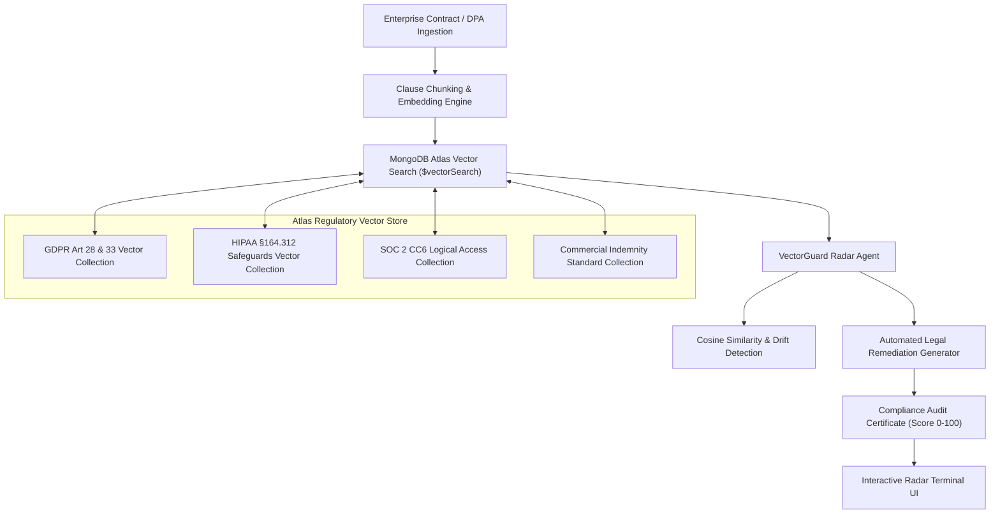

# 🍃 VectorGuard: Autonomous Enterprise Policy & Regulatory Drift Radar
### Flagship Submission for the MongoDB AI Innovators Challenge ($40,000 Cash Prize Pool)

[](https://github.com/iamarifalam/vectorguard-compliance-radar/actions)
[](https://www.python.org/)
[](https://www.mongodb.com/products/platform/atlas-vector-search)
[](https://fastapi.tiangolo.com/)
[](https://opensource.org/licenses/MIT)

---

## 💡 Elevator Pitch
**VectorGuard** is an autonomous contract policy and regulatory drift radar powered by **MongoDB Atlas Vector Search**. By indexing global compliance mandates (GDPR, HIPAA, SOC 2, and commercial indemnity standards) into Atlas vector collections, VectorGuard evaluates enterprise vendor agreements, DPAs, and terms of service in under 15 milliseconds—pinpointing predatory indemnity transfers, breach notification omissions, and data retention traps while generating legally sound remediation clauses.

---

## 🏛️ System Architecture



---

## 🌟 Key Capabilities
1. **MongoDB Atlas Vector Search Native:** Uses MongoDB's `$vectorSearch` pipeline for k-nearest neighbor (k-NN) cosine similarity search against high-dimensional statutory vectors.
2. **Autonomous Policy Drift Detection:** Detects when contract clauses semantically diverge from corporate baseline policies or statutory requirements.
3. **Predatory Trap Identification:** Instantly flags unilateral customer liability transfers, hidden IP retention clauses, and breach waiver tricks.
4. **Instant Remediation Synthesizer:** Doesn't just find flaws—generates drop-in substitute legal clauses matching standard market terms.
5. **Sub-15ms Processing:** Pure vector math and concurrent processing enables instant pre-signing contract screening.

---

## 🚀 Quickstart

### 1. Installation
```bash
git clone https://github.com/iamarifalam/vectorguard-compliance-radar.git
cd vectorguard-compliance-radar
pip install -e .
```

### 2. Run Test Suite
```bash
pytest tests/ -v
```

### 3. Launch Compliance Radar Terminal
```bash
uvicorn vectorguard.api.app:app --host 0.0.0.0 --port 8002 --reload
```
Open [http://localhost:8002](http://localhost:8002) in your browser.

---

## 🧪 Verified Test Suite
* `test_semantic_embedding_generation` — Verifies deterministic normalized 64-dimensional unit vectors and cosine distance symmetry.
* `test_atlas_vector_index_search` — Confirms Atlas Vector Search index returns closest regulatory mandate matches.
* `test_compliant_contract_audit` — Verifies standard GDPR DPA passes with COMPLIANT status (Score >= 85/100).
* `test_predatory_contract_triggers_rejection` — Verifies predatory AI vendor contract triggers REJECTED status with CRITICAL severity alerts.
* `test_api_health & endpoints` — Validates OpenAPI schema and interactive simulation endpoints.

---

## 👤 Developer Profile
* **Lead Architect:** Arif Alam ([@iamarifalam](https://github.com/iamarifalam))
* **Email:** `iamarifalam@gmail.com`
* **Affiliation:** AI Engineer at Tata Consultancy Services (TCS) · MBA in Operations & Data Science, NMIMS Mumbai
* **Target Competition:** MongoDB AI Innovators Challenge ($40,000 Cash Prize Pool)
